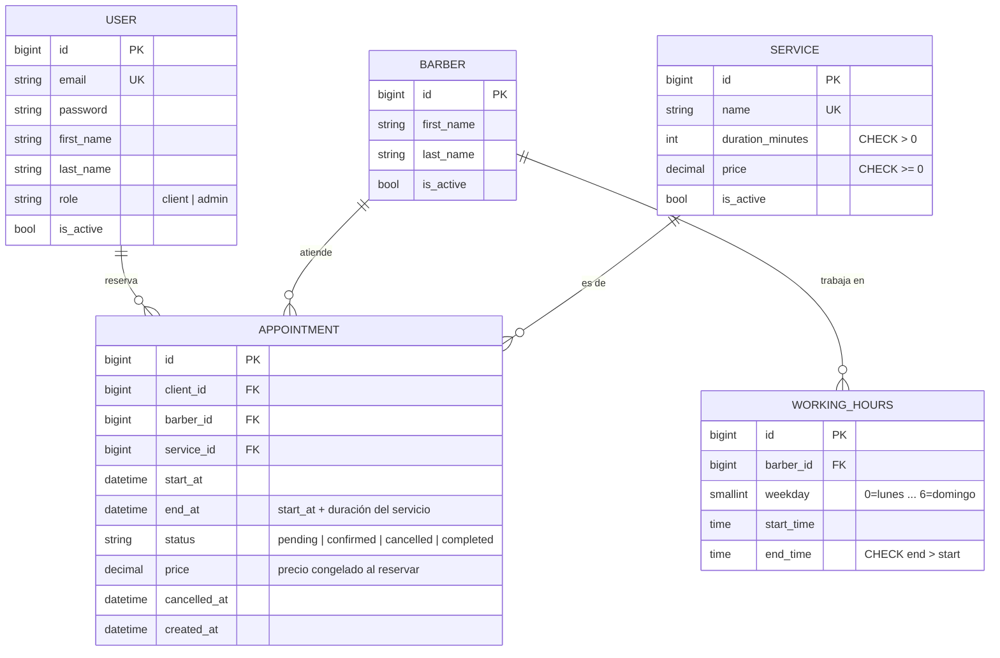

# PeluApp — API de turnos para una peluquería

[](https://github.com/LautaroCLM/peluapp/actions/workflows/ci.yml)

API REST para gestionar los turnos de una peluquería. Los clientes reservan un servicio con un peluquero
en un horario libre; el administrador gestiona servicios, peluqueros y horarios laborales.

**Demo:** _(pendiente de despliegue)_ · **Documentación interactiva (Swagger):** `/api/docs/`

## El problema

Reservar turnos parece simple hasta que aparecen los casos reales: dos clientes que quieren el mismo
horario al mismo tiempo, servicios de distinta duración, peluqueros con pausa de almuerzo, clientes que
cancelan a último momento. Este proyecto resuelve esos casos **en el servidor**, con reglas de negocio
verificadas por tests y garantizadas por la base de datos.

## Stack

Python 3.12 · Django 5.2 · Django REST Framework · PostgreSQL 16 · JWT (simplejwt) ·
drf-spectacular (OpenAPI) · pytest · Docker / Docker Compose · GitHub Actions · ruff

## Reglas de negocio

| # | Regla | Cómo se garantiza |
|---|---|---|
| 1 | Un peluquero no puede tener dos turnos superpuestos | Chequeo explícito (error 409 claro) **y** `ExclusionConstraint` de PostgreSQL como garantía final |
| 2 | Solo se reserva dentro del horario laboral y en el futuro | `services.create_appointment`: el turno debe caber entero en un bloque del peluquero |
| 3 | La duración la define el servicio | `end_at` lo calcula el servidor; el cliente no puede enviarlo |
| 4 | El cliente cancela con un mínimo de horas de anticipación | Configurable con `CANCELLATION_MIN_HOURS` (por defecto 24). El administrador cancela siempre |
| 5 | Cada cliente ve y modifica solo lo suyo; el administrador ve todo | El `queryset` se filtra por dueño. Un turno ajeno responde 404 |
| 6 | Horarios disponibles por peluquero, fecha y servicio | `GET /api/availability/` |
| 7 | Sin condiciones de carrera al reservar | `transaction.atomic()` + `SELECT ... FOR UPDATE` sobre el peluquero + restricción en la base |

## Modelo de datos



Restricciones en la base de datos (no solo en Python):

- `appt_no_overlap_per_barber`: `EXCLUDE USING gist (barber WITH =, tstzrange(start_at, end_at) WITH &&)`
  para turnos `pending` o `confirmed`. Un turno cancelado libera el horario.
- `CHECK` de duración positiva, precio no negativo, fin posterior al inicio y día de semana entre 0 y 6.
- Índices en `(barber, start_at)` y `(client, start_at)`.

## Cómo correrlo

### Con Docker (un solo comando)

```bash
docker compose up --build
```

Levanta PostgreSQL y la API, aplica las migraciones y deja todo en <http://localhost:8000/api/docs/>.
No hace falta crear un `.env`: el compose trae valores por defecto.

Para cargar datos de ejemplo:

```bash
docker compose exec web python manage.py seed_demo
```

Crea un administrador, 3 clientes, 5 servicios, 3 peluqueros con horarios y turnos de ejemplo.

| Usuario | Email | Contraseña |
|---|---|---|
| Administrador | `admin@peluqueria.test` | `admin12345` (cambiable con `--admin-password` o `SEED_ADMIN_PASSWORD`) |
| Clientes | `lucia@peluqueria.test`, `martin@peluqueria.test`, `sofia@peluqueria.test` | `cliente12345` |

### Sin Docker para la app (desarrollo local)

Requiere Python 3.12+ y una base PostgreSQL (se puede levantar solo la base con `docker compose up -d db`).

```bash
python -m venv .venv
source .venv/bin/activate          # En Windows: .venv\Scripts\activate
pip install -r requirements-dev.txt
cp .env.example .env               # y ajustar SECRET_KEY y DATABASE_URL
python manage.py migrate
python manage.py seed_demo
python manage.py runserver
```

### Tests y calidad

```bash
pytest                      # 92 tests, ~7 segundos (necesita PostgreSQL)
ruff check . && ruff format --check .
```

### Variables de entorno

Ver [.env.example](.env.example).

| Variable | Descripción | Por defecto |
|---|---|---|
| `SECRET_KEY` | Clave secreta de Django (obligatoria) | — |
| `DATABASE_URL` | Conexión a PostgreSQL (obligatoria) | — |
| `DEBUG` | Modo debug | `False` |
| `ALLOWED_HOSTS` | Hosts permitidos, separados por coma | `localhost,127.0.0.1` |
| `TIME_ZONE` | Zona en la que se interpretan los horarios laborales | `America/Argentina/Buenos_Aires` |
| `CANCELLATION_MIN_HOURS` | Horas mínimas de anticipación para que un cliente cancele | `24` |
| `SLOT_STEP_MINUTES` | Granularidad de los horarios ofrecidos | `15` |

## Endpoints

Todos bajo `/api/`. Documentación completa en `/api/docs/`.

| Método y ruta | Quién | Descripción |
|---|---|---|
| `POST /auth/register/` | Público | Registro (siempre crea un cliente) |
| `POST /auth/login/` | Público | Devuelve `access` y `refresh` (JWT) |
| `POST /auth/refresh/` | Público | Renueva el `access` con el `refresh` |
| `GET /services/`, `GET /barbers/` | Autenticado | Listar (los clientes ven solo los activos) |
| `POST/PUT/PATCH/DELETE /services/`, `/barbers/` | Administrador | CRUD |
| `/working-hours/` | Administrador | CRUD de horarios laborales (`?barber=`, `?weekday=`) |
| `GET /availability/?barber=&service=&date=` | Autenticado | Horarios disponibles |
| `POST /appointments/` | Autenticado | Reservar un turno |
| `GET /appointments/` | Autenticado | Listar (cliente: los suyos; administrador: todos) |
| `POST /appointments/{id}/cancel/` | Dueño o administrador | Cancelar |
| `POST /appointments/{id}/confirm/` | Administrador | Pendiente → confirmado |
| `POST /appointments/{id}/complete/` | Administrador | Confirmado → completado |

Los listados están paginados (20 por página) y admiten filtros. Por ejemplo, en turnos:
`?status=`, `?barber=`, `?service=`, `?start_from=`, `?start_to=` y `?ordering=start_at`.
En servicios: `?min_price=`, `?max_price=`, `?search=` y `?is_active=`.

## Ejemplos con curl

Con la API levantada y los datos de ejemplo cargados.

**1. Registrarse** (siempre se crea con rol cliente, aunque se envíe otro):

```bash
curl -X POST http://localhost:8000/api/auth/register/ \
  -H "Content-Type: application/json" \
  -d '{"email": "nuevo@example.com", "password": "UnaClaveSegura77", "first_name": "Ana"}'
```

**2. Iniciar sesión** y guardar el token:

```bash
curl -X POST http://localhost:8000/api/auth/login/ \
  -H "Content-Type: application/json" \
  -d '{"email": "lucia@peluqueria.test", "password": "cliente12345"}'
# {"refresh": "...", "access": "..."}

TOKEN="<pegar acá el access>"
```

**3. Renovar el token de acceso:**

```bash
curl -X POST http://localhost:8000/api/auth/refresh/ \
  -H "Content-Type: application/json" \
  -d '{"refresh": "<refresh token>"}'
```

**4. Ver los servicios disponibles:**

```bash
curl http://localhost:8000/api/services/ -H "Authorization: Bearer $TOKEN"
```

**5. Consultar horarios libres** del peluquero 1, servicio 1, un jueves (el seed carga horarios de martes a sábado):

```bash
curl "http://localhost:8000/api/availability/?barber=1&service=1&date=2026-12-03" \
  -H "Authorization: Bearer $TOKEN"
```

```json
{
  "barber": 1,
  "service": 1,
  "date": "2026-12-03",
  "slots": [
    {"start": "2026-12-03T09:00:00-03:00", "end": "2026-12-03T09:30:00-03:00"},
    {"start": "2026-12-03T09:15:00-03:00", "end": "2026-12-03T09:45:00-03:00"}
  ]
}
```

**6. Reservar un turno** (el fin y el precio los calcula el servidor):

```bash
curl -X POST http://localhost:8000/api/appointments/ \
  -H "Authorization: Bearer $TOKEN" -H "Content-Type: application/json" \
  -d '{"barber": 1, "service": 1, "start_at": "2026-12-03T10:00:00-03:00"}'
```

```json
{"id": 8, "client": 2, "barber": 1, "service": 1,
 "start_at": "2026-12-03T10:00:00-03:00", "end_at": "2026-12-03T10:30:00-03:00",
 "status": "pending", "price": "5000.00", "cancelled_at": null, "created_at": "..."}
```

Si ya está ocupado: `409 {"detail": "El peluquero ya tiene un turno en ese horario."}`.

**7. Listar mis turnos con filtros:**

```bash
curl "http://localhost:8000/api/appointments/?status=pending&ordering=start_at" \
  -H "Authorization: Bearer $TOKEN"
```

**8. Cancelar un turno:**

```bash
curl -X POST http://localhost:8000/api/appointments/8/cancel/ -H "Authorization: Bearer $TOKEN"
```

Si faltan menos horas que `CANCELLATION_MIN_HOURS`, un cliente recibe `400`; un administrador puede cancelar igual.

**9. Como administrador:** crear un servicio y confirmar un turno.

```bash
ADMIN=$(curl -s -X POST http://localhost:8000/api/auth/login/ \
  -H "Content-Type: application/json" \
  -d '{"email": "admin@peluqueria.test", "password": "admin12345"}' \
  | python -c "import sys,json; print(json.load(sys.stdin)['access'])")

curl -X POST http://localhost:8000/api/services/ \
  -H "Authorization: Bearer $ADMIN" -H "Content-Type: application/json" \
  -d '{"name": "Perfilado de cejas", "duration_minutes": 15, "price": "1500.00"}'

# Confirmar un turno pendiente (con el seed, el 4 está pendiente)
curl -X POST http://localhost:8000/api/appointments/4/confirm/ -H "Authorization: Bearer $ADMIN"
```

## Decisiones técnicas

- **Reglas en una capa de servicios** (`apps/appointments/services.py`). Las vistas solo traducen HTTP.
  Así las reglas se testean sin pasar por la API y se reutilizan (por ejemplo, el seed pasa por ellas).
- **Anti-superposición en dos niveles.** El lock sobre la fila del peluquero serializa las reservas
  concurrentes y permite devolver un error legible. La `ExclusionConstraint` de PostgreSQL es la garantía
  final: aunque alguien se saltee el servicio, la base rechaza la superposición. Por eso los tests corren
  contra PostgreSQL real y no SQLite.
- **Intervalos semiabiertos.** Un turno de 10:00 a 10:30 y otro de 10:30 a 11:00 no se pisan. Es la misma
  semántica en el algoritmo de disponibilidad, en el chequeo y en la restricción de la base.
- **`end_at` y `price` los define el servidor.** El precio se congela al reservar: si el servicio sube de
  precio, los turnos ya tomados no cambian.
- **Cancelar libera el horario.** La restricción solo considera turnos `pending` y `confirmed`.
- **Turnos ajenos responden 404, no 403,** para no revelar que existen.
- **Sin PUT, PATCH ni DELETE en turnos.** El estado cambia solo mediante acciones con reglas
  (`cancel`, `confirm`, `complete`). Para cambiar de horario se cancela y se reserva de nuevo.
- **Borrado seguro.** Servicios, peluqueros y clientes con turnos usan `on_delete=PROTECT`: no se pierde
  el historial. Si se intenta borrar un servicio o peluquero con turnos, la API responde 409 y sugiere
  desactivarlo (`is_active=false`).
- **Registro sin escalada de privilegios.** El rol nunca se acepta del cliente: quien se registra es siempre `client`.
- **Zona horaria.** La base guarda UTC; los horarios laborales se interpretan en `TIME_ZONE`.
- **Tests rápidos.** Los tests usan un hasher de contraseñas rápido (MD5, solo en tests). Pasó la suite de
  ~250 s a ~7 s: el costo estaba en PBKDF2, no en la base.
- **Configuración por variables de entorno** (12-factor), con la misma imagen para local, CI y producción.

### Qué quedó afuera a propósito

Pagos, notificaciones, frontend, reprogramación de turnos y lista negra de tokens JWT (logout del lado servidor).
Son extensiones razonables, pero fuera del alcance de este proyecto.

## Estructura

```
config/                  Configuración de Django (settings, urls)
apps/accounts/           Usuario con email y rol, JWT, permisos
apps/catalog/            Peluqueros, servicios y horarios laborales
apps/appointments/       Turnos: modelo, reglas (services.py), disponibilidad, API, seed
tests/                   Tests de modelos, auth, catálogo, disponibilidad, turnos y concurrencia
.github/workflows/       CI: ruff + migraciones + pytest con PostgreSQL
Dockerfile, docker-compose.yml
```
